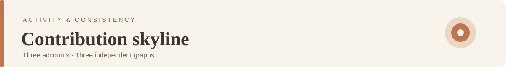
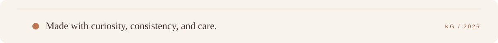

  

  
<strong>Web development · Software projects · Experiments</strong>

  

    <a href="https://github.com/whatelsekartik">GitHub</a>
    &nbsp;·&nbsp;
    <a href="https://github.com/whatelsekartik?tab=repositories">Browse repositories</a>
    &nbsp;·&nbsp;
    <a href="https://github.com/whatelsekartik/portfolio">Portfolio source</a>
  

---

I enjoy turning ideas into useful software, exploring new approaches, and paying attention to the details that make digital experiences feel considered.

<table>
  <tr>
    <td width="50%" align="center" valign="top">
      <strong>01 / WHATELSEKARTIK</strong>  
      
       <a href="https://github.com/whatelsekartik">View account ↗</a>
    </td>
    <td width="50%" align="center" valign="top">
      <strong>02 / AMINOTKARTIK</strong>  
      
       <a href="https://github.com/aminotkartik">View account ↗</a>
    </td>
  </tr>
</table>

  <strong>03 / SITEMANGO</strong>  
  
   <a href="https://github.com/sitemango">View account ↗</a>

Each graph is generated separately and refreshed by GitHub Actions.

